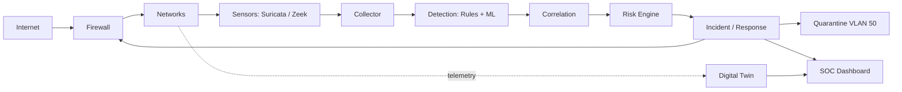

# INSOC-DT

**Intelligent Network Security & Digital Twin SOC**

Monitor → Detect → Analyze → Correlate → Risk Score → Decide → Respond → Verify

This repository is the **team guide and workspace** of the project: the weekly plan, the code,
the lab files, the research and every project document.

## Start here

1. Read the specification: [docs/project/INSOC-DT-spec.pdf](docs/project/INSOC-DT-spec.pdf)
2. Read the [team guide](docs/team-guide.md) (roles, weekly routine, how to upload files)
3. Open the current week in [weeks/](weeks/README.md) and pick your tasks
4. Work on a branch and open a PR into `develop` ([CONTRIBUTING.md](CONTRIBUTING.md))

## Team roles

| Tag | Role | Main areas |
|---|---|---|
| LEAD | Team lead / integration | repo, reviews, demo, final report |
| NET | Network engineer | `lab/`, digital twin |
| SEC | Security engineer | sensors, detection, correlation, response |
| ML | ML engineer | datasets, models, risk weights, research |
| DASH | Dashboard engineer | dashboard, incidents |

## 12-week plan

The schedule is a starting point. The lead can shift weeks, but keep the order.

| Week | Focus | Owner | Status |
|---|---|---|---|
| [1](weeks/week-01/README.md) | Kickoff and foundations | LEAD | Not started |
| [2](weeks/week-02/README.md) | Lab network | NET | Not started |
| [3](weeks/week-03/README.md) | Sensors and baseline traffic | SEC | Not started |
| [4](weeks/week-04/README.md) | Collector and signature detection | SEC | Not started |
| [5](weeks/week-05/README.md) | Behavioral detection and ML data | ML | Not started |
| [6](weeks/week-06/README.md) | Model training and comparison | ML | Not started |
| [7](weeks/week-07/README.md) | Correlation and risk engine | SEC | Not started |
| [8](weeks/week-08/README.md) | Automated response | SEC | Not started |
| [9](weeks/week-09/README.md) | Digital twin | NET | Not started |
| [10](weeks/week-10/README.md) | Dashboard and incident management | DASH | Not started |
| [11](weeks/week-11/README.md) | Integration and evaluation | LEAD | Not started |
| [12](weeks/week-12/README.md) | Demo, final report and release | LEAD | Not started |

Update the Status column in your PR when a week finishes (`In progress`, `Done`).

### Week 1: Kickoff and foundations

**Goal:** Everyone can work in the repo, knows their role and has the tools installed.  
**Owner:** LEAD  
**Deliverables:** Team roles table; Tools checklist per member; 2 paper summaries; Lab topology sketch  
**Done when:** Every member merged at least one PR into `develop`.  
[Full plan](weeks/week-01/README.md)

### Week 2: Lab network

**Goal:** A working virtual enterprise network with the five VLANs.  
**Owner:** NET  
**Deliverables:** Topology export; Device configs; Connectivity test screenshots  
**Done when:** A ping matrix between VLANs matches the intended policy.  
[Full plan](weeks/week-02/README.md)

### Week 3: Sensors and baseline traffic

**Goal:** Suricata and Zeek see the traffic and write JSON logs.  
**Owner:** SEC  
**Deliverables:** Sensor configs; Sample `eve.json` and `conn.log` (small, no real data); Screenshots  
**Done when:** A test scan from Kali produces a Suricata alert and Zeek conn records.  
[Full plan](weeks/week-03/README.md)

### Week 4: Collector and signature detection

**Goal:** Events are parsed, normalized and signature rules fire reliably.  
**Owner:** SEC  
**Deliverables:** Event schema document; Rule list with test evidence  
**Done when:** Generated attacks are detected and the tests pass in CI.  
[Full plan](weeks/week-04/README.md)

### Week 5: Behavioral detection and ML data

**Goal:** Behavioral rules work and the ML dataset and features are ready.  
**Owner:** ML  
**Deliverables:** Dataset notes; Feature list; EDA notebook or report  
**Done when:** Features can be computed from both the public dataset and lab logs.  
[Full plan](weeks/week-05/README.md)

### Week 6: Model training and comparison

**Goal:** Random Forest baseline compared with Decision Tree, Logistic Regression and XGBoost.  
**Owner:** ML  
**Deliverables:** Model comparison report; Confusion matrices; Chosen model and why  
**Done when:** Report with all metrics for all four models, reviewed by the lead.  
[Full plan](weeks/week-06/README.md)

### Week 7: Correlation and risk engine

**Goal:** Alerts become incidents with a 0-100 risk score.  
**Owner:** SEC  
**Deliverables:** Risk model description; Asset criticality table; Sample incident JSON  
**Done when:** A port scan becomes one incident with the expected risk level.  
[Full plan](weeks/week-07/README.md)

### Week 8: Automated response

**Goal:** Blocking, isolation and rollback work safely and are verified.  
**Owner:** SEC  
**Deliverables:** Response actions description; Audit log sample; Before/after screenshots  
**Done when:** A Critical incident blocks the attacker, a rollback restores access, all logged.  
[Full plan](weeks/week-08/README.md)

### Week 9: Digital twin

**Goal:** A network model that answers what-if questions.  
**Owner:** NET  
**Deliverables:** Model description; Scenario results; Model vs lab comparison  
**Done when:** Router failure simulation matches what happens in the real lab.  
[Full plan](weeks/week-09/README.md)

### Week 10: Dashboard and incident management

**Goal:** A SOC dashboard with roles and the full incident lifecycle.  
**Owner:** DASH  
**Deliverables:** Dashboard screenshots; Role permission table  
**Done when:** Each role sees only what it should, and the demo incident shows end to end.  
[Full plan](weeks/week-10/README.md)

### Week 11: Integration and evaluation

**Goal:** The full pipeline runs and the metrics are measured.  
**Owner:** LEAD  
**Deliverables:** Evaluation report with tables and charts  
**Done when:** Every metric in the spec has a measured value.  
[Full plan](weeks/week-11/README.md)

### Week 12: Demo, final report and release

**Goal:** A rehearsed demo, final documents and release `v1.0`.  
**Owner:** LEAD  
**Deliverables:** Final report; Slides; Demo video link; Release notes  
**Done when:** `main` is tagged `v1.0` and the demo runs without edits.  
[Full plan](weeks/week-12/README.md)

## Architecture



## Repository layout

| Folder | Content |
|---|---|
| `weeks/` | Weekly plans and the files each week produces |
| `src/insoc/` | All Python code: collector, detection, ml, risk, response, twin, incidents, dashboard |
| `lab/` | EVE-NG/GNS3 topologies, device configs, VLAN plan, Suricata/Zeek configuration |
| `research/` | Papers, dataset notes, experiments, references |
| `docs/` | Team guide, architecture, governance, project files, diagrams |
| `demo/` | Final demo flow |
| `tests/` | Unit and integration tests |
| `scripts/` | Repository tooling |
| `.github/` | CI, PR template, CODEOWNERS, branch rulesets |

## Lab network

| VLAN | Name | Subnet |
|---|---|---|
| 10 | Management | 10.10.10.0/24 |
| 20 | Users | 10.10.20.0/24 |
| 30 | Servers | 10.10.30.0/24 |
| 40 | Security | 10.10.40.0/24 |
| 50 | Quarantine | 10.10.50.0/24 |

## Risk scoring

| Score | Level | Action |
|---|---|---|
| 0-30 | Low | Log only |
| 31-60 | Medium | Alert |
| 61-80 | High | Alert + temporary block |
| 81-100 | Critical | Automated response |

Safety: allowlists, thresholds, expirations, rollback, audit logs.

## Quick start (code)

```bash
pip install -r requirements-dev.txt
pytest
ruff check .
```

## Workflow

`topic branch` → PR → `develop` → PR → `main`. Details: [docs/governance.md](docs/governance.md).
